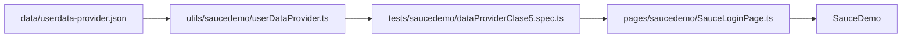

# Data Provider de SauceDemo

## Objetivo

El Data Provider separa los datos de prueba de la lógica del test. Permite ejecutar el mismo flujo de autenticación con distintos usuarios sin copiar y pegar casos completos.

La implementación usa un archivo JSON como fuente de datos y una función TypeScript que carga, tipifica y valida cada escenario antes de registrarlo en Playwright.

## Arquitectura



| Capa | Responsabilidad |
| --- | --- |
| `data/userdata-provider.json` | Define entradas y resultados esperados. No contiene lógica de Playwright. |
| `utils/saucedemo/userDataProvider.ts` | Lee el JSON, valida su estructura y devuelve objetos `UserData` tipados. |
| `tests/saucedemo/dataProviderClase5.spec.ts` | Genera un test independiente por cada usuario y decide qué verificar según el resultado esperado. |
| `pages/saucedemo/SauceLoginPage.ts` | Encapsula locators, navegación y acciones de la pantalla de login. |

El spec no debe importar el JSON directamente. Siempre debe usar `loadUserData()` para evitar que datos incompletos o con tipos incorrectos lleguen al test.

## Contrato de datos

Cada escenario del JSON debe incluir estos campos:

| Campo | Tipo | Descripción |
| --- | --- | --- |
| `scenario` | `string` | Nombre legible que aparecerá en el reporte. |
| `userName` | `string` | Usuario que se ingresa en SauceDemo. |
| `password` | `string` | Contraseña del usuario. |
| `expectSuccess` | `boolean` | `true` si debe abrir el inventario; `false` si debe mostrar un error. |
| `msjError` | `string` | Mensaje esperado para un resultado fallido. En casos exitosos se usa `""`. |

Ejemplo exitoso:

```json
"standard": {
  "scenario": "Usuario estándar",
  "userName": "standard_user",
  "password": "secret_sauce",
  "expectSuccess": true,
  "msjError": ""
}
```

Ejemplo fallido:

```json
"lockedOut": {
  "scenario": "Usuario bloqueado",
  "userName": "locked_out_user",
  "password": "secret_sauce",
  "expectSuccess": false,
  "msjError": "Epic sadface: Sorry, this user has been locked out."
}
```

## Flujo de ejecución

1. Playwright carga el archivo `dataProviderClase5.spec.ts`.
2. El spec llama a `loadUserData()`.
3. El proveedor lee y convierte el JSON.
4. El proveedor valida todos los campos. Si encuentra un dato inválido, detiene la ejecución con un mensaje que identifica el escenario y el campo.
5. El bucle `users.forEach(...)` registra un test independiente por escenario.
6. Cada test usa `SauceLoginPage` para abrir SauceDemo e iniciar sesión.
7. El test verifica el inventario cuando `expectSuccess` es `true`, o `msjError` cuando es `false`.

La suite se ejecuta en modo serial porque incluye `performance_glitch_user`, un usuario que introduce demora intencional. Esto evita que esa latencia afecte los demás escenarios cuando el proyecto tiene `fullyParallel: true`.

## Agregar un escenario

1. Abrir `data/userdata-provider.json`.
2. Agregar una clave única con los cinco campos obligatorios.
3. Definir correctamente `expectSuccess`.
4. Si el escenario debe fallar, completar `msjError` con el texto exacto esperado.
5. Ejecutar las validaciones:

```bash
npm run typecheck
npx playwright test tests/saucedemo/userDataProvider.spec.ts
npx playwright test tests/saucedemo/dataProviderClase5.spec.ts
```

No es necesario modificar el spec para sumar otro usuario que respete el mismo flujo de login.

## Validaciones del proveedor

`loadUserData()` rechaza:

- un JSON cuya raíz no sea un objeto;
- escenarios que no sean objetos;
- `scenario`, `userName` o `password` vacíos;
- `expectSuccess` con un valor que no sea booleano;
- `msjError` con un valor que no sea texto;
- escenarios fallidos sin mensaje de error.

Estas validaciones hacen que un problema de datos falle al comienzo y no como un error confuso dentro del navegador.

## Errores frecuentes

### `has no exported member 'UserData'`

El spec está importando un tipo que el proveedor no exporta, o el nombre no coincide. Usar las exportaciones actuales:

```ts
import { loadUserData } from "../../utils/saucedemo/userDataProvider";
```

### El usuario bloqueado espera el inventario

Revisar que el escenario tenga:

```json
"expectSuccess": false
```

### Un caso lento no encuentra `Products`

El Page Object espera el título estable `[data-test="title"]` con un timeout especial para el usuario de rendimiento. No agregar `waitForTimeout`; las esperas deben depender de una condición observable.

### Diferencias entre `userName` y `username`

El proveedor JSON usa `userName`. El CSV histórico `data/saucedemo-users.csv` usa `username` y pertenece a una implementación anterior. No mezclar ambos contratos en el mismo test.

## Reglas de mantenimiento

- Mantener los datos en `data/`, la carga y validación en `utils/`, y las acciones de interfaz en `pages/`.
- No duplicar credenciales dentro del spec.
- No importar el JSON directamente desde un test.
- No agregar condicionales por nombre de usuario; usar el resultado esperado declarado en los datos.
- Ejecutar `npm run typecheck` después de cambiar tipos, imports o campos.
- Mantener un nombre de escenario claro porque forma parte del reporte de Playwright.

## Archivos relacionados

- `data/userdata-provider.json`
- `utils/saucedemo/userDataProvider.ts`
- `tests/saucedemo/userDataProvider.spec.ts`
- `tests/saucedemo/dataProviderClase5.spec.ts`
- `pages/saucedemo/SauceLoginPage.ts`
- `playwright.config.ts`
