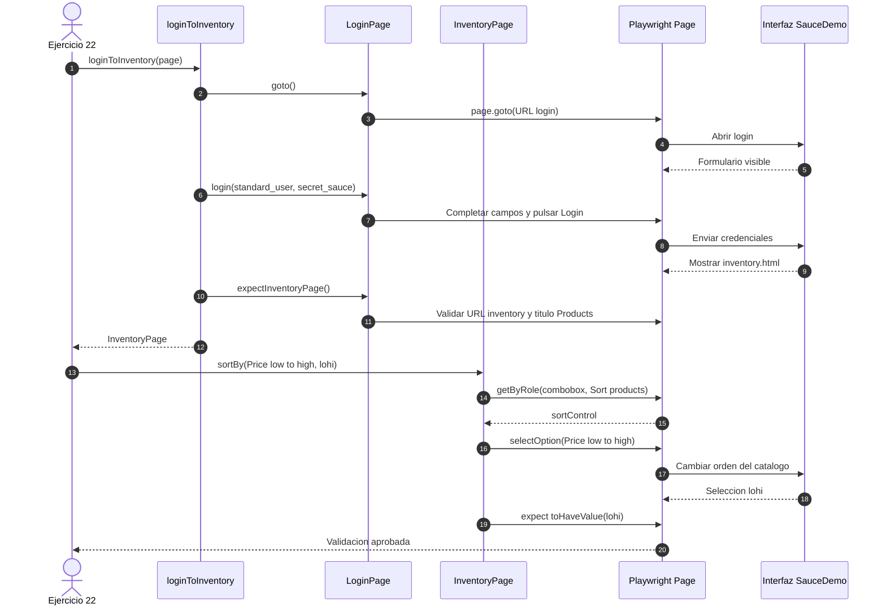
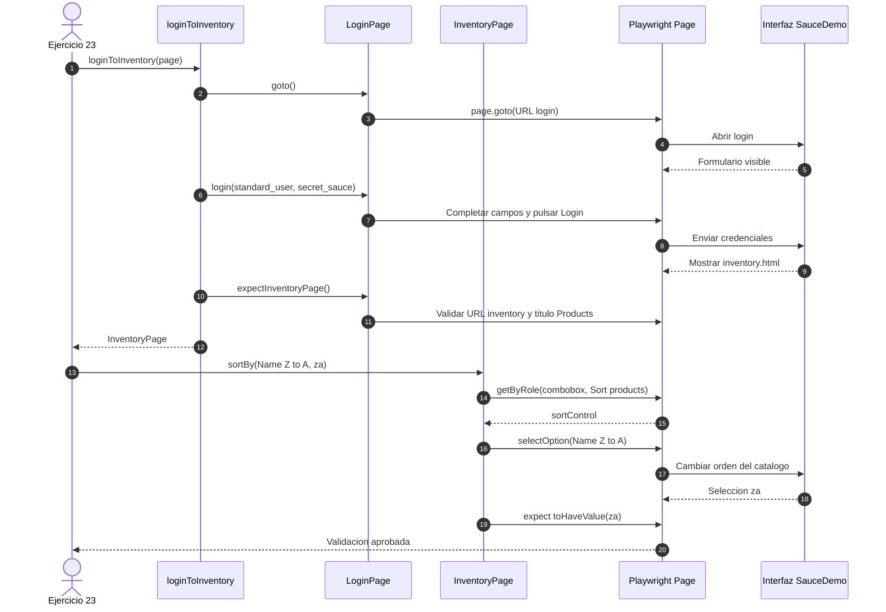
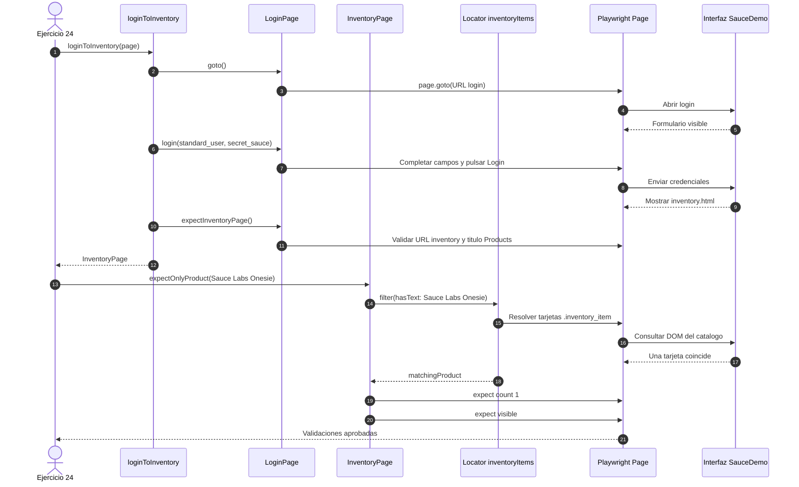
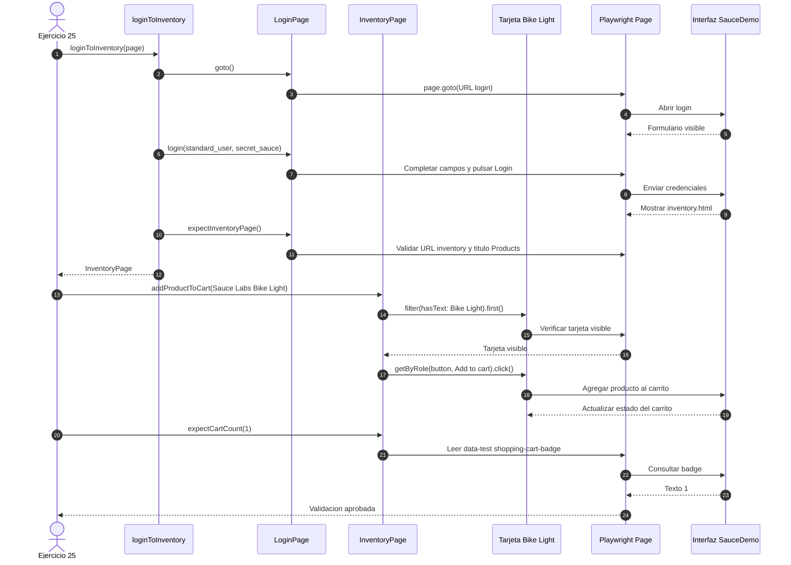

# SauceDemo: Secuencias de los ejercicios 22-25

## Preparacion del proyecto

Clona directamente la rama que contiene los ejercicios y entra en la carpeta del proyecto:

```bash
git clone --branch feature/clase-4-pom --single-branch https://github.com/diego22993/qc-automation-pw.git
cd qc-automation-pw
```

Cada diagrama representa un test independiente. Todos parten de la sesion iniciada y del inventario cargado mediante `loginToInventory(page)`.

## Guia breve para alumnos

**Objetivo:** practicar como un test delega acciones en un Page Object, usa locators claros y verifica el resultado esperado. No hace falta resolver los cuatro ejercicios de una vez: completa y ejecuta uno antes de continuar.

1. Revisa el diagrama del ejercicio y localiza la accion que le corresponde a `InventoryPage`.
2. Implementa o completa el metodo del Page Object; evita poner toda la interaccion directamente en el test.
3. En el test, usa `test.step` para separar la accion de su verificacion.
4. Ejecuta solo ese ejercicio y comprueba el resultado esperado que aparece en el diagrama.
5. Si pasa, continua con el siguiente; al final ejecuta los cuatro juntos.

**Meta de cada ejercicio:**

- Ejercicio 22: seleccionar `Price (low to high)` y verificar el valor `lohi`.
- Ejercicio 23: seleccionar `Name (Z to A)` y verificar el valor `za`.
- Ejercicio 24: filtrar las tarjetas por `Sauce Labs Onesie` y comprobar que el locator encuentra una sola tarjeta visible.
- Ejercicio 25: agregar `Sauce Labs Bike Light` desde su tarjeta y comprobar que el badge del carrito muestre `1`.

**Comandos de verificacion:**

```powershell
npx playwright test tests/saucedemo/saucedemo.test.ts --grep "Ejercicio 22"
npx playwright test tests/saucedemo/saucedemo.test.ts --grep "Ejercicio 23"
npx playwright test tests/saucedemo/saucedemo.test.ts --grep "Ejercicio 24"
npx playwright test tests/saucedemo/saucedemo.test.ts --grep "Ejercicio 25"
npx playwright test tests/saucedemo/saucedemo.test.ts --grep "Ejercicio 2[2-5]"
```

## Ejercicio 22: Ordenar por precio ascendente



## Ejercicio 23: Ordenar por nombre descendente



## Ejercicio 24: Filtrar Sauce Labs Onesie



## Ejercicio 25: Agregar Bike Light y validar badge

